<!-- The images in assets/ are generated from chasesunstrom.dev's own code: see scripts/readme. -->

<a href="https://www.chasesunstrom.dev"></a>

  <a href="https://www.chasesunstrom.dev"><picture><source media="(prefers-color-scheme: light)" srcset="assets/btn-site-light.svg">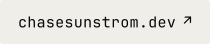</picture></a>
  <a href="https://www.chasesunstrom.dev/chase-sunstrom-resume.pdf"><picture><source media="(prefers-color-scheme: light)" srcset="assets/btn-resume-light.svg">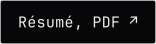</picture></a>
  <a href="https://www.linkedin.com/in/chase-sunstrom-326040279/"><picture><source media="(prefers-color-scheme: light)" srcset="assets/btn-linkedin-light.svg">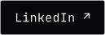</picture></a>
  <a href="mailto:resume.record819@passmail.com"><picture><source media="(prefers-color-scheme: light)" srcset="assets/btn-email-light.svg"></picture></a>

<picture><source media="(prefers-color-scheme: light)" srcset="assets/heading-projects-light.svg">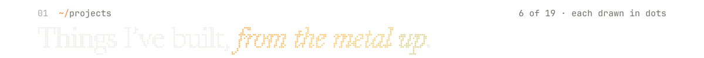</picture>

  <a href="https://github.com/ChaseSunstrom/volt-bootstrap">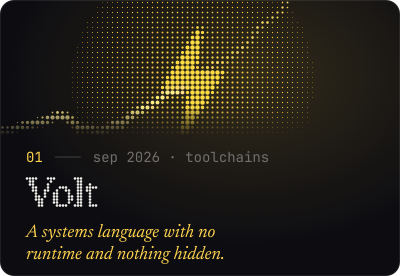</a>
  <a href="https://github.com/ChaseSunstrom/cforge">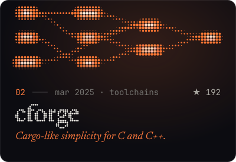</a>
  <a href="https://github.com/ChaseSunstrom/rust-raytracer">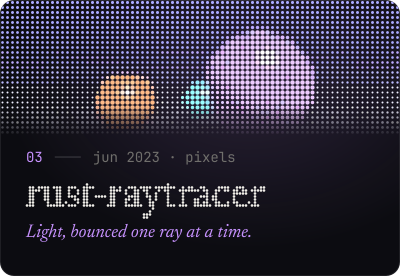</a>
  <a href="https://github.com/ChaseSunstrom/nixie">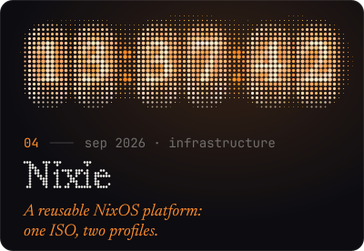</a>
  <a href="https://github.com/ChaseSunstrom/foreman">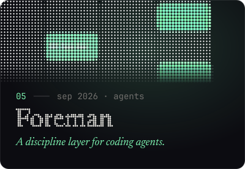</a>
  <a href="https://github.com/ChaseSunstrom/jarvis">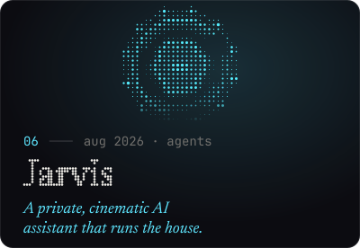</a>

